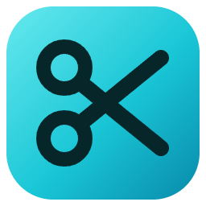
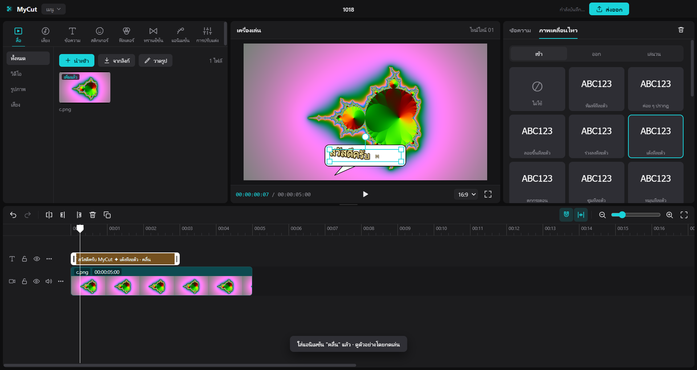
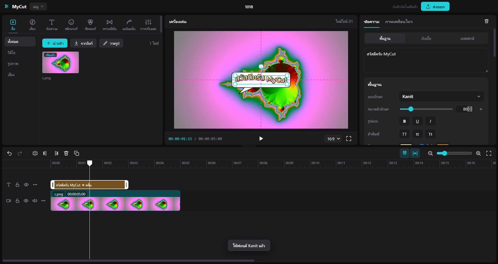
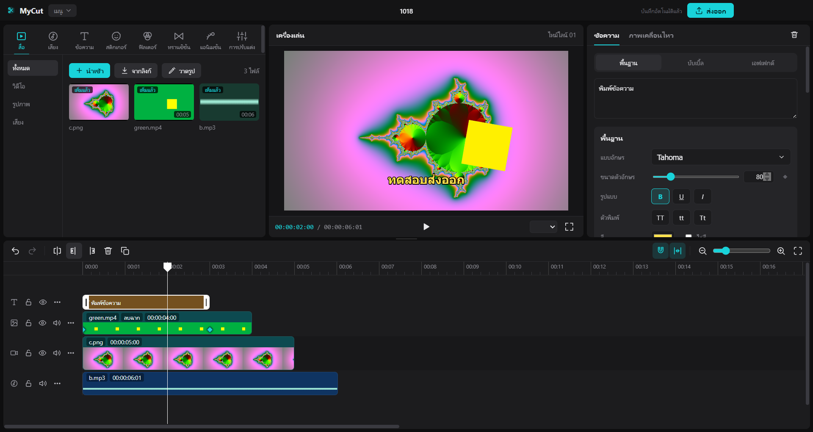

<h1 align="center">MyCut</h1>

<b>โปรแกรมตัดต่อวิดีโอฟรีสำหรับ Windows — ใช้งานง่าย ไม่มีรายเดือน</b>

  <a href="../../releases/latest"><b>⬇️ ดาวน์โหลด MyCut (ตัวติดตั้ง .exe)</b></a>

## ✨ ทำอะไรได้บ้าง

- 🎬 **ตัดต่อบนไทม์ไลน์** — แทร็กไม่จำกัด, แทร็กหลักแบบแม่เหล็ก, แบ่ง/ตัด/ลากยืดคลิป, Ctrl+Z ย้อนกลับ
- 🔤 **ข้อความ** — ฟอนต์ไทยจาก Google Fonts (Kanit, Prompt, Sarabun …), สไตล์สำเร็จรูป, เงา, เรืองแสง, บับเบิ้ล, เอฟเฟกต์
- 💫 **แอนิเมชัน** — เข้า / ออก / เล่นวน, ขยับทีละตัวอักษร, คีย์เฟรม ◆ (ย้าย ย่อขยาย หมุน จาง)
- 🟩 **ลบฉากเขียว** (Chroma key) สำหรับวิดีโอและรูป
- 🎨 **ฟิลเตอร์ & ทรานซิชัน** — ลากไปวางบนคลิปได้เลย
- 😀 **สติกเกอร์** และ ✏️ **วาดรูปในโปรแกรม**
- 🎵 **เสียง** — นำเข้าเพลง, ฟังก่อนเพิ่ม, อัดเสียงพากย์จากไมค์, แยกเสียงจากวิดีโอ
- ⬇️ **ดาวน์โหลดคลิป/เสียงจากลิงก์** (YouTube ฯลฯ)
- 📤 **ส่งออก MP4** 480p – 4K, แนวนอน 16:9 / แนวตั้ง 9:16 (TikTok, Reels) / 1:1

| ข้อความสวย ๆ | ลบฉากเขียว |
|---|---|
|  |  |

## 💻 วิธีติดตั้ง

1. ไปที่หน้า **[Releases](../../releases/latest)** แล้วดาวน์โหลดไฟล์ `MyCut-Setup-x.x.x.exe`
2. ดับเบิลคลิกไฟล์ที่โหลดมา
3. ถ้า Windows ขึ้นหน้าจอสีน้ำเงิน **“Windows protected your PC”**
   ให้กด **More info (ข้อมูลเพิ่มเติม)** → **Run anyway (เรียกใช้ต่อไป)**
   *(ขึ้นเพราะโปรแกรมยังไม่มีใบรับรองลายเซ็นดิจิทัลแบบเสียเงิน)*
4. กดถัดไปจนเสร็จ จะมีไอคอน **MyCut** บนเดสก์ท็อป

**ต้องการ:** Windows 10 / 11 (64-bit) · ไม่ต้องติดตั้งโปรแกรมอื่นเพิ่ม

## ❓ คำถามที่พบบ่อย

- **ฟรีจริงไหม?** ฟรี ไม่มีรายเดือน ไม่มีลายน้ำ
- **ไฟล์งานเก็บที่ไหน?** โปรเจกต์บันทึกอัตโนมัติในเครื่อง (`%APPDATA%\MyCut`) วิดีโอที่ส่งออกอยู่ในโฟลเดอร์ *วิดีโอ*
- **ถอนการติดตั้ง?** การตั้งค่า Windows › แอป › MyCut › ถอนการติดตั้ง

## 📄 ข้อตกลงการใช้งาน

- ใช้ฟรี ห้ามนำไปขาย หรืออ้างว่าเป็นผลงานของตัวเอง
- ฟีเจอร์ดาวน์โหลดจากลิงก์ ใช้กับคลิปที่คุณมีสิทธิ์ใช้เท่านั้น (คลิปของตัวเอง หรือที่เจ้าของอนุญาต)
- โปรแกรมนี้ใช้ซอฟต์แวร์ของบุคคลที่สาม: Electron (MIT), FFmpeg (GPL v3 — ซอร์สโค้ดที่ [ffmpeg.org](https://ffmpeg.org/download.html)), yt-dlp (Unlicense) — รายละเอียดใน [THIRD-PARTY-NOTICES.txt](THIRD-PARTY-NOTICES.txt)
